# DC Motor Position Control: Model-Based Design with MIL Verification

Position control of a DC motor developed with a model-based design workflow in MATLAB/Simulink:
measurable requirements, a physics-based plant model validated against theory, controller design
decisions backed by measurements, and an automated model-in-the-loop (MIL) test suite.

> **Scope.** This project covers the left side of the V-model and MIL verification:
> requirements, plant and sensor modelling, controller design and automated testing.
> Code generation and SIL/HIL verification are out of scope and listed in the [roadmap](#roadmap).

**Status (v1.1):** 28/28 checks PASS — 6 model validation checks, 21 requirement checks, 1 test-infrastructure check.

*Türkçe özet: [README_TR.md](README_TR.md)*

### What's new in v1.1

- **Discrete-time controller** at Ts = 1 ms, with a sample-time study showing where the requirements
  break (between 100 and 200 ms) → [details](#discrete-time-controller-and-sample-time-margin)
- **Closed-loop load torque** under worst-case conditions (hot winding, supply sag, higher friction);
  a hand-calculated capacity predicts the pass/fail boundary in all 16 cases → [details](#load-torque-and-worst-case-analysis)
- **Multi-step reference** 0 → 50 → 20 → 80 rad, which exposed a slow settling tail that single-step
  tests had hidden → [details](#multi-step-reference-and-the-slow-tail)
- **Refactoring under regression:** the reference block was replaced and the plots/annotations cleaned
  up with every previous result reproduced exactly

---

## Contents

- [System overview](#system-overview)
- [Quick start](#quick-start)
- [Repository structure](#repository-structure)
- [Plant model](#plant-model)
- [Requirements and results](#requirements-and-results)
- [Design decisions](#design-decisions)
- [Load torque and worst-case analysis](#load-torque-and-worst-case-analysis)
- [Multi-step reference and the slow tail](#multi-step-reference-and-the-slow-tail)
- [Discrete-time controller and sample-time margin](#discrete-time-controller-and-sample-time-margin)
- [Verification approach](#verification-approach)
- [Measurement methodology](#measurement-methodology)
- [Known limitations](#known-limitations)
- [Roadmap](#roadmap)

---

## System overview

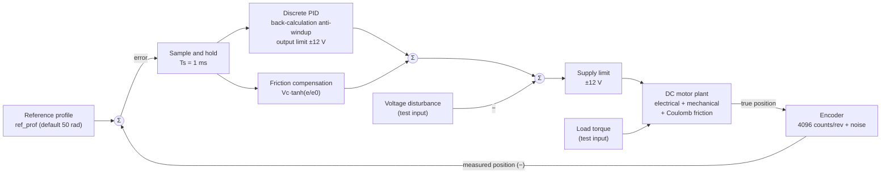

The motor is continuous-time; the controller (sample-and-hold, PID and friction compensation) runs at 1 kHz.

**Top-level model** (click to open full size)

[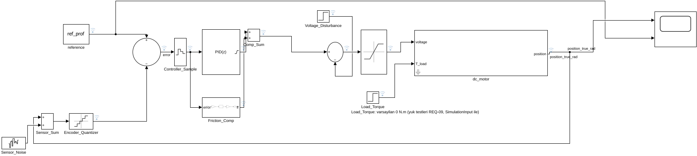](docs/model_top_level.svg)

**Plant: `dc_motor` subsystem** (click to open full size)

[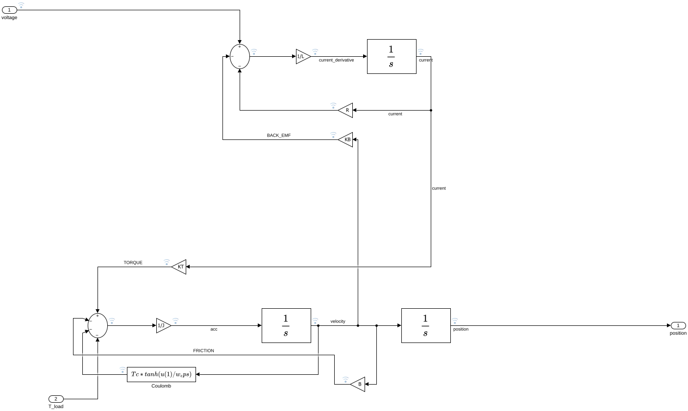](docs/model_dc_motor.svg)

---

## Quick start

1. Open MATLAB and open the project:
   ```matlab
   openProject('DC_Motor_Position_Control_MBD.prj')
   ```
   This adds `models/` and `tests/` to the path and changes to the project root.
2. Run the full test suite (about 5–10 minutes, ~70 simulations):
   ```matlab
   run_all_tests
   ```
3. Results are written to `results/`:
   - `test_ozeti.csv` — requirement summary (ID, description, measured value, limit, PASS/FAIL)
   - `test_ozeti_surekli.csv` — the same summary with the continuous-time controller, kept for comparison
   - `test_raporu.txt` — full console report
   - `*.png` — all plots shown in this README

**Tested with:** MATLAB/Simulink R2026a, Control System Toolbox (`ss`, `step`, `stepinfo`).

All parameters live in a single file, [`models/init_motor.m`](models/init_motor.m),
which the model loads automatically through its `InitFcn` callback.

---

## Repository structure

```
├── models/    Simulink model and init_motor.m (all parameters: motor, sensor, controller, reference)
├── tests/     run_all_tests.m and the individual test / plotting scripts
├── results/   Plots, summary tables and report produced by the tests
├── docs/      Model diagrams used in this README
├── tools/     One-time scripts that built or changed the model (kept as a record, not on the path)
└── archive/   Earlier versions of the model and scripts (not on the project path)
```

| Test script | Verifies |
|---|---|
| `test_model_validation.m` | Plant model against closed-form theory and a state-space model |
| `check_logs.m` | 17 internal equations from reference to motor position, encoder plausibility |
| `run_antiwindup_test.m` | Step response, anti-windup comparison (REQ-01…05) |
| `run_disturbance_test.m` | Steady-state error under a 3 V disturbance (REQ-06b) |
| `run_disturbance_sweep.m` | Disturbance amplitudes 3–13 V (REQ-06a, 06c) |
| `run_param_sweep.m` | R and J varied ±20 % (REQ-08) |
| `run_sensor_test.m` | Encoder, noise and derivative filter N (REQ-07a) |
| `run_encoder_test.m` | Noise-free encoder and friction-compensation width e0 (REQ-07b) |
| `run_load_torque_test.m` | Closed-loop load torque 0.1–0.8 N·m, holding voltage (MODEL-E) |
| `run_load_worstcase.m` | Load torque under four worst-case conditions (REQ-09, REQ-04w) |
| `run_multistep_test.m` | Reference sequence 0 → 50 → 20 → 80 rad (REQ-10) |
| `run_sample_time_test.m` | Controller sample time 1–500 ms (REQ-11) |

No test modifies or saves the model: every test sets its conditions through
`Simulink.SimulationInput`, and `run_all_tests` checks at the end that the model settings are unchanged.

---

## Plant model

The motor is built from its physical equations rather than a library block:

```math
L \frac{di}{dt} = V - R i - K_b \omega
```

```math
J \frac{d\omega}{dt} = K_t i - B \omega - T_c \tanh\left(\frac{\omega}{\omega_\varepsilon}\right) - T_L
```

```math
\frac{d\theta}{dt} = \omega
```

| Parameter | Value | Unit | Note |
|---|---|---|---|
| J | 0.03 | kg·m² | rotor inertia |
| B | 0.01 | N·m·s/rad | viscous friction |
| K_t, K_b | 0.5 | N·m/A, V·s/rad | torque / back-EMF constant |
| R | 8 | Ω | armature resistance |
| L | 0.45 | H | armature inductance |
| T_c | 0.05 | N·m | Coulomb friction (~7 % of stall torque, assumed) |
| ω_ε | 0.01 | rad/s | tanh smoothing of Coulomb friction |
| Encoder | 2π/4096 | rad | 1024 CPR × 4 |
| Measurement noise | 0.001 | rad (1σ) | assumed, generated at 1 kHz |
| Supply limit | ±12 | V | |

Derived figures: maximum speed at 12 V ≈ 17.0 rad/s (with friction), dominant mechanical time
constant ≈ 0.7 s, voltage needed to overcome Coulomb friction T_c·R/K_t = 0.8 V, largest load torque
the motor can still move against at 12 V: K_t·V/R − T_c = 0.70 N·m.

**Validation.** With 1 V applied in open loop, the steady-state speed matches the closed-form result
ω = (K_t·V/R − T_c − T_L) / (B + K_t·K_b/R) within a relative error of about 2·10⁻⁶ in three cases
(no friction, Coulomb friction, load torque — the last one also confirms the sign of the load input).
Without friction, the full position trajectory matches a state-space model within 0.03 %.
In closed loop, the motor voltage needed to hold a load matches T_L·R/K_t within 0.5 % (MODEL-E).

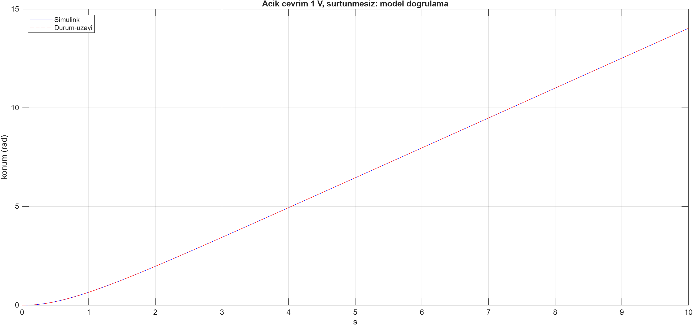

---

## Requirements and results

Final configuration: discrete-time PID at Ts = 1 ms (Kp = 11.23, Ki = 7.23, Kd = 4.17, N = 50),
back-calculation anti-windup, friction compensation Vc = 0.8 V, e0 = 0.01 rad, encoder and noise enabled.

| ID | Requirement | Measured | Limit | Result |
|---|---|---|---|---|
| REQ-01 | Reaches the 50 rad target (settling occurs) | 4.03 s | finite | PASS |
| REQ-02 | Steady-state error | 4.2·10⁻⁵ rad | < 0.5 rad | PASS |
| REQ-03 | Overshoot | 0.28 % | < 5 % | PASS |
| REQ-04 | Settling time (2 % band) | 4.03 s | < 5 s | PASS |
| REQ-04w | Settling time under worst-case conditions | 4.68 s | < 5 s | PASS |
| REQ-05 | Motor voltage | 12.0 V | ≤ 12 V | PASS |
| REQ-06a | Max. deviation under a 9 V disturbance | 0.51 rad | ≤ 1 rad | PASS |
| REQ-06b | Steady-state error after a 3 V disturbance | 1.7·10⁻⁵ rad | < 0.01 rad | PASS |
| REQ-06c | Return to ±0.05 rad after a 9 V disturbance | 4.11 s | < 5 s | PASS |
| REQ-07a | Voltage ripple at standstill, encoder + noise (AC rms) | 0.31 V | < 0.5 V (peak < 1.5 V) | PASS |
| REQ-07b | Voltage ripple at standstill, noise-free encoder (AC rms) | 0.001 V | < 0.5 V (peak < 1.5 V) | PASS |
| REQ-08 | REQ-02…05 with R and J varied ±20 % (9 cases); worst settling | 4.37 s | all pass | PASS |
| REQ-09a | 0.4 N·m load step, worst case: max. deviation | 0.42 rad | ≤ 1 rad | PASS |
| REQ-09b | 0.4 N·m load step, worst case: steady-state error | 0.0037 rad | < 0.01 rad | PASS |
| REQ-09c | 0.4 N·m load step, worst case: return to ±0.05 rad | 4.41 s | < 5 s | PASS |
| REQ-10a | Step sequence 0 → 50 → 20 → 80 rad: largest overshoot | 0.28 % | < 5 % | PASS |
| REQ-10b | Step sequence: longest settling time | 4.56 s | < 5 s | PASS |
| REQ-10c | Step sequence: settling difference vs. the same step from rest | 0.003 s | < 0.05 s | PASS |
| REQ-10d | Step sequence: error before the next step | 0.032 rad | < 0.05 rad | PASS |
| REQ-11a | REQ-02…05 and 07a hold for Ts ≤ 10 ms (10× nominal); overshoot at 10 ms | 0.32 % | all pass | PASS |
| REQ-11b | Largest sample time at which they still hold | 100 ms | ≥ 50 ms | PASS |

Worst case for REQ-04w and REQ-09: winding resistance +20 % (hot motor), supply 11 V, Coulomb friction ×1.5.

The tightest margins are REQ-04w (0.32 s), REQ-10d (0.018 rad) and REQ-09c (0.59 s). Settling time is
limited by the motor's top speed at 12 V, so controller tuning has little influence on it.

| Disturbance sweep | Parameter sweep (R, J ±20 %) |
|---|---|
| 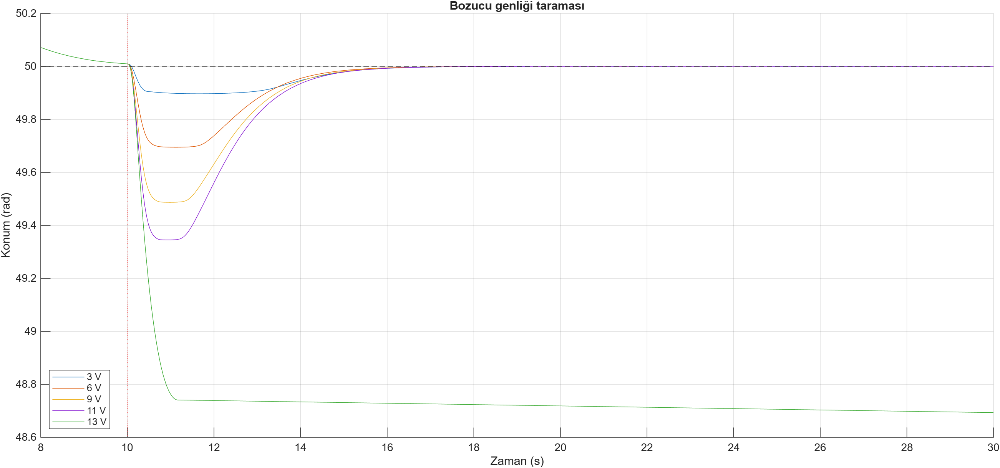 | 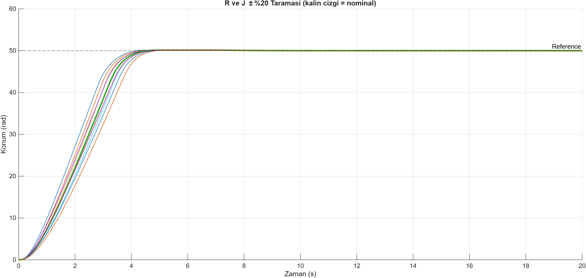 |

---

## Design decisions

Every controller choice was made by measuring alternatives against the requirements.

### 1. Anti-windup: back-calculation

A 50 rad step saturates the 12 V supply for about 3 s, and the integrator winds up.

| Method | Overshoot | Settling |
|---|---|---|
| none | 80.3 % | 13.3 s |
| clamping | 1.75 % | 3.78 s |
| **back-calculation** | **0.28 %** | **4.03 s** |

Clamping shows a shorter settling time only because its overshoot (1.75 %) falls just inside the
2 % band; before friction was added it was 2.08 % and settled in 4.67 s. Back-calculation was chosen
for its consistently low overshoot.

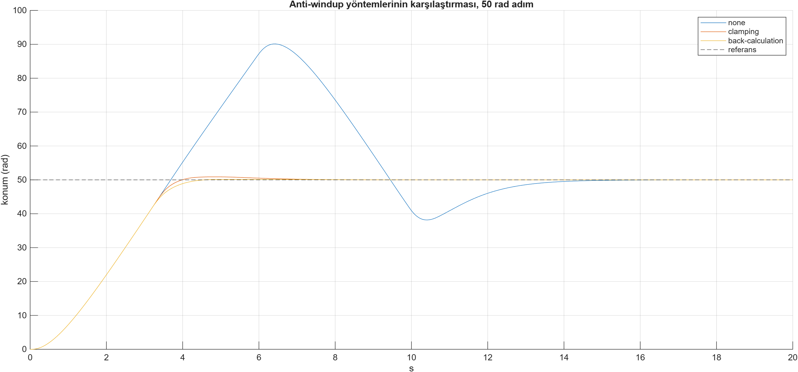

### 2. Derivative filter N = 50 (instead of the PID Tuner's 1010)

The PID Tuner assumes ideal measurement. With an encoder, every count step produced a large spike
through the derivative term, and with noise the motor voltage chattered across the full ±12 V
at standstill — invisible in the position plot, which the motor's inertia smooths out.

| N | Standstill ripple (AC rms) | Settling |
|---|---|---|
| 1010 | 2.71 V | 4.00 s |
| 200 | 0.88 V | 4.01 s |
| **50** | **0.31 V** | **4.03 s** |
| 20 | 0.18 V | 4.08 s |

Values measured with the discrete-time controller (v1.1). N was chosen in v1.0 with the continuous-time
controller, where N = 1010 gave 5.4 V; the choice holds in both. Reducing N from 1010 to 50 cost 0.03 s
of settling time.

| Standstill voltage per case | Trade-off |
|---|---|
| 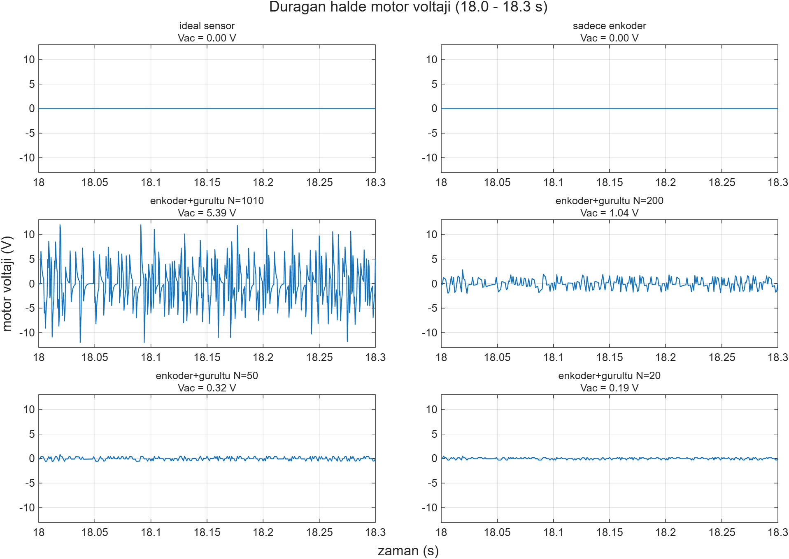 | 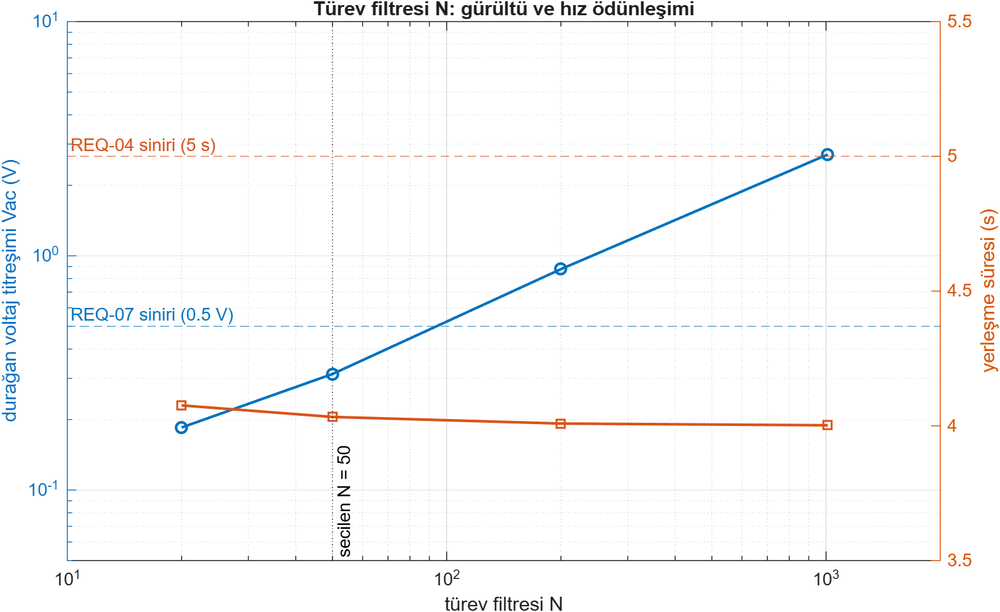 |

### 3. Coulomb friction compensation

With Coulomb friction added, the PID could overcome friction only slowly through its integral term.
The position crept towards the target and REQ-06b failed (0.017 rad). An error-based feed-forward
term was added in parallel to the PID:

```math
u_{ff} = V_c \tanh\left(\frac{e}{e_0}\right), \qquad V_c = \frac{T_c R}{K_t} = 0.8 \text{ V}
```

An error-based form was used because no velocity sensor is modelled and the reference is a step.
The compensation uses **nominal** motor parameters, as a real controller would.

| | Without compensation | With compensation |
|---|---|---|
| Mean position error at standstill | ≈ 0.015 rad (≈ 10 encoder counts) | 2·10⁻⁵ – 2.4·10⁻⁴ rad |
| REQ-06b | FAIL (0.017 rad) | PASS (1.7·10⁻⁵ rad) |

### 4. Compensation width e0 = 0.01 rad

e0 sets how steep the compensation is around the target. With a noise-free encoder:

| e0 | Ripple (AC rms) | Mean error | Behaviour |
|---|---|---|---|
| 0.005 | 0.13 V | 0.6 counts | limit cycle (hunting) between two encoder counts |
| **0.01** | **0.001 V** | **0.15 counts** | flat, no hunting |
| 0.02 | 0.03 V | 0.7 counts | too weak near the target, friction holds the motor |

e0 = 0.01 gave both the lowest error and the lowest ripple, with and without noise.

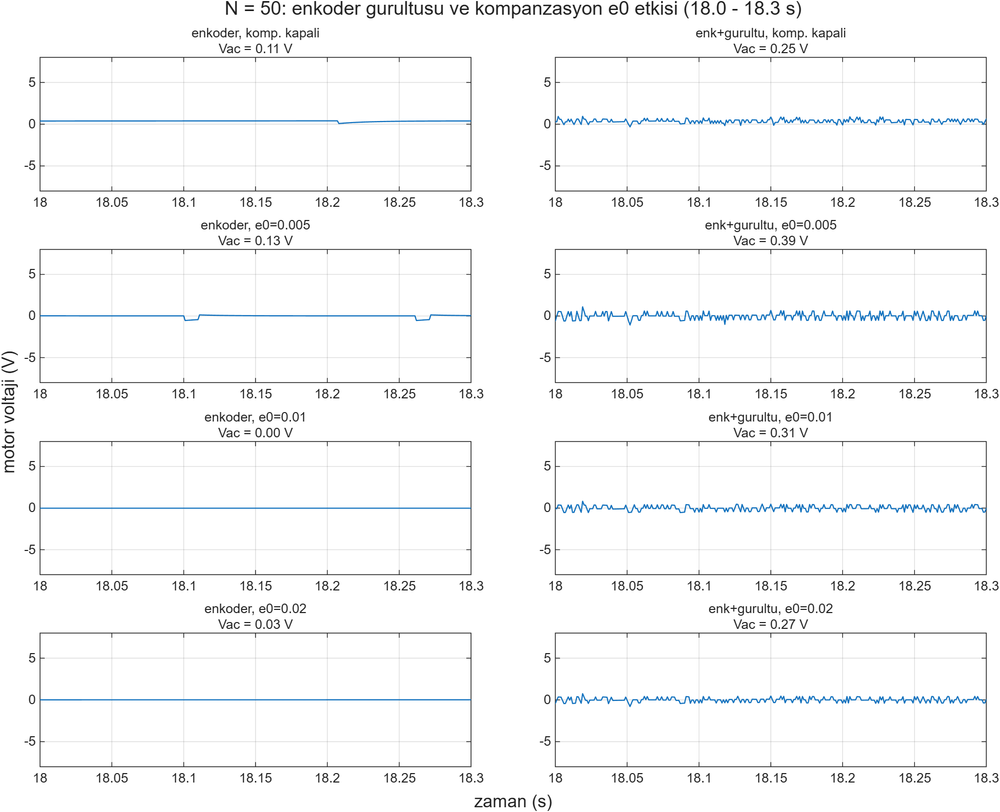

---

## Load torque and worst-case analysis

A load torque step is applied while the motor holds 50 rad. Two simple relations from the plant
equations explain all results:

```math
T_{L,\max} = \frac{K_t V_{supply}}{R} - T_c \qquad\qquad V_{hold} = \frac{T_L R}{K_t}
```

The first is the largest load the motor can still move against, the second the voltage needed to hold
a load at standstill. Under nominal conditions T_L,max = 0.70 N·m: loads up to 0.6 N·m are rejected,
0.7 N·m leaves the motor creeping back slowly, and 0.8 N·m drags it away.

**Worst-case conditions.** A real motor does not stay at its nominal values. Three effects were applied
to the **plant only** — the controller keeps its nominal parameters, as it would in reality:
a hot winding (R × 1.2, roughly +50 °C copper temperature), supply sag to 11 V, and friction × 1.5.

| Condition | Capacity (hand calc.) | Largest load that passes | First load that fails | Step settling |
|---|---|---|---|---|
| Nominal | 0.700 N·m | 0.6 N·m | — | 4.03 s |
| Hot winding | 0.575 N·m | 0.5 N·m | 0.6 N·m | 4.26 s |
| Hot + 11 V | 0.523 N·m | 0.5 N·m | 0.6 N·m | 4.52 s |
| Hot + 11 V + friction × 1.5 | 0.498 N·m | 0.4 N·m | 0.5 N·m | 4.68 s |

The hand-calculated capacity predicted the pass/fail boundary in all 16 simulations — an independent
check of the model. REQ-09 was therefore set at **0.4 N·m under the worst case**, not at the nominal
0.6 N·m. The same analysis showed that step settling degrades to 4.68 s under these conditions,
which became REQ-04w.

**How far can the assumptions be wrong?** Starting from the worst case and degrading one more parameter
until the 0.4 N·m requirement fails:

| Parameter | Worst-case value | Value at which REQ-09 fails |
|---|---|---|
| K_t (magnet strength) | 0.5 | 0.414 (17 % weaker) |
| R | 9.6 Ω | 11.6 Ω (1.45 × nominal) |
| T_c | 0.075 N·m | 0.173 N·m (3.5 × nominal) |

REQ-09 is verified in MIL only. The margins show the result holds even if K_t is 17 % lower or friction
3.5× higher than assumed; hardware validation is out of scope.

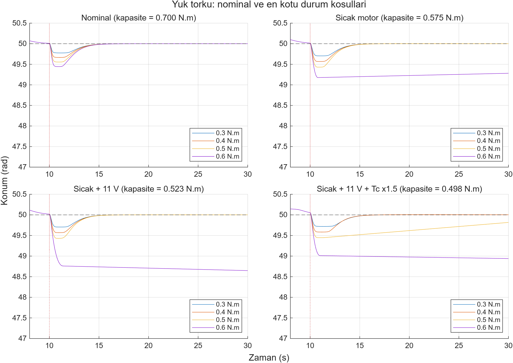

---

## Multi-step reference and the slow tail

The reference is now a time profile (`ref_prof` in `init_motor.m`; the default reproduces the constant
50 rad of v1.0). The sequence 0 → 50 → 20 → 80 rad with 10 s between steps tests three things a single
step cannot: whether the controller carries anything over from the previous move, whether a reverse
step behaves the same, and a step larger than the one it was tuned for.

| Step | Size | Overshoot | Settling | Same step from rest | Error before next step |
|---|---|---|---|---|---|
| 0 → 50 | +50 rad | 0.28 % | 4.033 s | 4.033 s | 0.032 rad |
| 50 → 20 | −30 rad | 0.26 % | 3.033 s | 3.036 s | 0.018 rad |
| 20 → 80 | +60 rad | 0.27 % | 4.556 s | 4.557 s | 0.0003 rad (15 s window) |

Each step behaves like the same step started from rest (difference ≤ 0.003 s), so nothing is carried
over between moves, and the reverse step saturates symmetrically at −12 V.

**Finding: a slow settling tail.** The error before the next step (0.032 rad) is about 800 times larger
than the steady-state error measured in REQ-02, which waits 20 s. The motor enters the 2 % band in about
4 s, but the 0.28 % overshoot — 0.14 rad — then decays with a time constant of roughly 1.4 s, so reaching
0.01 rad takes about 10 s. This matches the slow dynamics added by the PID's integral term
(Ki/Kp ≈ 0.64 s⁻¹): the integrator charged during the approach cancels most of the proportional
pull-back after the target is passed.

The first hypothesis, that the motor stalls in friction near the target, was ruled out from the logged
signals: the friction compensation sits at ±0.8 V throughout the tail, exactly cancelling Coulomb friction.
REQ-10d bounds the tail at 0.05 rad; reducing it with a 2-DOF PID is planned for v1.2.

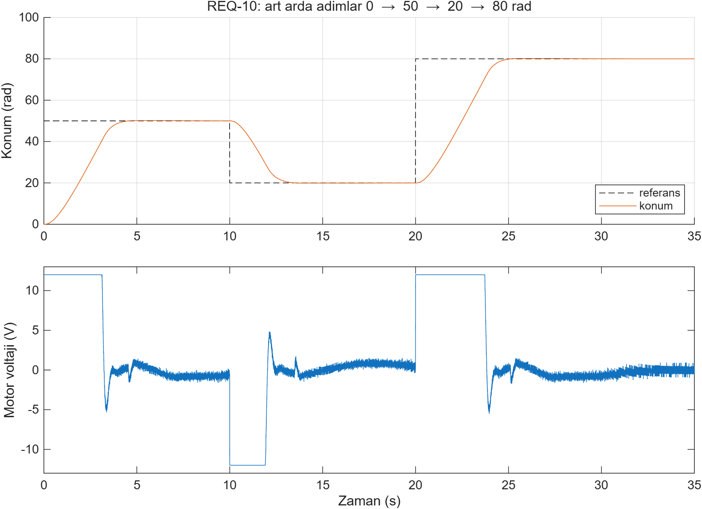

---

## Discrete-time controller and sample-time margin

A real controller reads the encoder, computes and updates the voltage at fixed intervals. The error
signal is now sampled by a zero-order hold, and the PID and friction compensation run at Ts = 1 ms
(PID: forward-Euler integrator, backward-Euler derivative filter, which stays stable for any N·Ts).

**Continuous vs. discrete at 1 ms** — practically no change, because the measurement noise was already
generated at 1 kHz and the closed loop responds in seconds:

| | Continuous | Discrete, 1 ms |
|---|---|---|
| Overshoot (REQ-03) | 0.28 % | 0.28 % |
| Settling (REQ-04 / REQ-04w) | 4.033 / 4.678 s | 4.033 / 4.679 s |
| Ripple (REQ-07a) | 0.325 V | 0.313 V |
| Return after load (REQ-09c) | 4.408 s | 4.407 s |

**How slow can the controller be?** The sample time was swept from 1 to 500 ms on the nominal step:

| Ts | Overshoot | Settling | Steady-state error | Ripple (AC rms) | Result |
|---|---|---|---|---|---|
| 1 ms | 0.28 % | 4.03 s | 4·10⁻⁵ rad | 0.31 V | PASS |
| 10 ms | 0.32 % | 4.04 s | 6·10⁻⁵ rad | 0.26 V | PASS |
| 50 ms | 0.47 % | 4.04 s | 6·10⁻⁵ rad | 0.18 V | PASS |
| 100 ms | 1.11 % | 4.06 s | 5·10⁻⁵ rad | 0.16 V | PASS |
| 200 ms | 2.68 % | 5.85 s | 0.84 rad | 10.6 V | FAIL — limit cycle |
| 500 ms | 7.11 % | — | 3.34 rad | 12.0 V | FAIL — limit cycle |

- **Two opposing effects.** A longer Ts adds delay, so overshoot rises. It also divides the noise in the
  derivative term by a larger Ts, so ripple falls — until the loop loses stability.
- **The boundary lies between 100 and 200 ms,** consistent with a rough estimate from the closed-loop
  bandwidth (~1 rad/s, sampled 10–30× faster). Beyond it the position oscillates indefinitely and the
  voltage switches between ±12 V; at 500 ms one oscillation lasts exactly four samples.
- **Overshoot alone would have missed it.** At 200 ms the overshoot is still below 5 %; only the
  steady-state error and the ripple detect the failure.
- **Committed margin.** The sweep covers only the nominal step, so the requirement commits to 10 ms
  (REQ-11a), ten times below the observed boundary. REQ-11b flags any future change that halves the
  timing robustness.

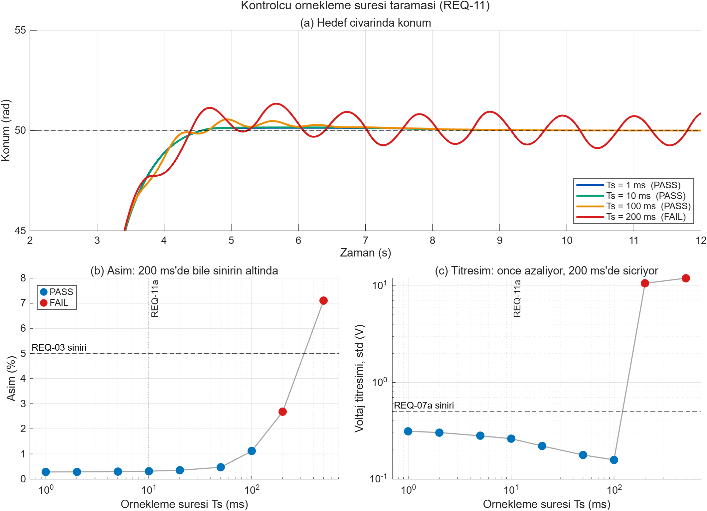

---

## Verification approach

- **Plant validated independently** of the controller, against theory and a state-space model.
- **Internal consistency:** `check_logs` re-computes 17 equations from logged signals (motor
  electrical and mechanical chain, friction, sampling, compensation, summing junctions, saturation)
  and checks encoder plausibility. All match to numerical precision.
- **Structural changes made with zero values first.** Friction, load input and compensation were
  added with zero gain, the full test suite was shown to give identical results, and only then were
  the values switched on.
- **Refactoring under regression.** In v1.1 the reference block was replaced (Constant → From Workspace)
  and the model annotations and test plots were cleaned up; each time all previous results were
  reproduced exactly before the change was committed.
- **Hand calculations as independent checks.** Load capacity, holding voltage and the sample-time
  boundary were estimated before simulating and compared with the results.
- **Regression:** `run_all_tests` re-runs everything after any change. It caught real problems during
  development — for example, a parameter sweep that had left the plant at 1.2×R and 1.2×J.
- **Tests never modify the model**, and this is checked automatically.
- **Single source of parameters:** every value in the model and the tests comes from `init_motor.m`.

---

## Measurement methodology

Several measurement definitions were refined during development once the model became more
realistic. They are listed here so the numbers above can be interpreted correctly.

- **Windowed averages with noise.** Steady-state values (e.g. REQ-06b) are averaged over the last
  5 s. A single sample showed 3.079 V and 1.6·10⁻⁴ rad; the windowed mean gave 3.000 V and 2·10⁻⁵ rad.
- **REQ-07 measures the AC component in a stationary window (15–20 s).** With friction, the motor
  holds a small constant voltage against friction, which is not noise. An earlier 8–20 s window also
  contained the final creep towards the target and showed 0.3 V of "ripple" even with an ideal sensor;
  in 15–20 s the ideal-sensor ripple is 0.00005 V.
- **REQ-06c and REQ-09c use an absolute ±0.05 rad band.** A band relative to the deviation (2 %) became
  very narrow for small deviations and exaggerated recovery times.
- **REQ-10 measures each step in its own window,** relative to the step time and the step size
  (`stepinfo` always measures from t = 0). The error before the next step is the mean of the last 2 s.
- **REQ-11b is the last sample time before the first failure,** not the largest passing one, so an
  isolated pass beyond a failure cannot inflate the margin.
- **Settling time is sensitive near 2 % overshoot.** See the clamping case in design decision 1.

---

## Known limitations

- Plant parameters are representative values, not measured; a real project would start with
  parameter identification on the motor.
- The `tanh` friction model does not reproduce true stiction (stick–slip), and the motor driver's
  current limit is not modelled.
- T_c = 0.05 N·m and the 0.001 rad noise level are assumptions, not datasheet values.
- Holding 0.4 N·m draws 0.8 A continuously (≈ 6 W in the winding); whether the motor tolerates this
  thermally depends on its datasheet.
- The compensation is added after the PID's internal limit; the total command can reach 12.8 V before
  the supply limit clips it, and the PID's anti-windup does not see that clipping.
- The compensation uses nominal parameters; under worst-case conditions the steady-state error rises
  from 3·10⁻⁵ to 0.0037 rad (still within REQ-09b).
- Voltage disturbances of 12 V or more cannot be rejected in general. The 13 V case is held at
  ≈ 1.3 rad only because friction absorbs the remaining −0.2 V.
- Slow settling tail: reaching 0.01 rad takes about 10 s (REQ-10d bounds it at 0.05 rad).
- Computation delay and jitter of a real controller are not modelled, and the sample-time sweep
  covers the nominal step only.
- Plot labels are in Turkish.

---

## Roadmap

- **v1.0** — plant model and validation, PID with anti-windup, sensor model, friction compensation,
  automated MIL suite (17 checks).
- **v1.1** — closed-loop load torque and worst-case analysis, multi-step reference, discrete-time
  controller and sample-time study (28 checks).
- **v1.2** — 2-DOF PID (set-point weighting) to remove the slow tail, developed on a feature branch
  under the full regression; stiction and driver current limit in the plant.
- **Later** — frequency-domain analysis (Bode, gain/phase margins), cascaded speed/position control,
  Monte Carlo parameter study, Simulink Test / Requirements Toolbox, Model Advisor checks,
  code generation and MIL-vs-SIL back-to-back testing.

---

## Archive

`archive/` keeps earlier models and scripts for reference; it is not on the project path.
An intermediate snapshot (sensor added, N = 50, before friction) was lost while reorganising the
folders; the current model supersedes it.

## License

MIT (see `LICENSE`).
