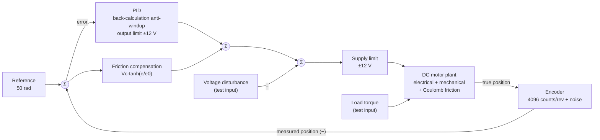

# DC Motor Position Control: Model-Based Design with MIL Verification

Position control of a DC motor developed with a model-based design workflow in MATLAB/Simulink:
measurable requirements, a physics-based plant model validated against theory, controller design
decisions backed by measurements, and an automated model-in-the-loop (MIL) test suite.

> **Scope.** This project covers the left side of the V-model and MIL verification:
> requirements, plant and sensor modelling, controller design and automated testing.
> Code generation and SIL/HIL verification are out of scope and listed in the [roadmap](#roadmap).

**Status (v1.0):** 17/17 checks PASS — 5 model validation checks, 11 requirement checks, 1 test-infrastructure check.

*Türkçe özet: [README_TR.md](README_TR.md)*

---

## Contents

- [System overview](#system-overview)
- [Quick start](#quick-start)
- [Repository structure](#repository-structure)
- [Plant model](#plant-model)
- [Requirements and results](#requirements-and-results)
- [Design decisions](#design-decisions)
- [Verification approach](#verification-approach)
- [Measurement methodology](#measurement-methodology)
- [Known limitations](#known-limitations)
- [Roadmap](#roadmap)

---

## System overview



| Top level | Plant (`dc_motor` subsystem) |
|---|---|
|  |  |

---

## Quick start

1. Open MATLAB and open the project:
   ```matlab
   openProject('DC_Motor_Position_Control_MBD.prj')
   ```
   This adds `models/` and `tests/` to the path and changes to the project root.
2. Run the full test suite (about 5–10 minutes, ~35 simulations):
   ```matlab
   run_all_tests
   ```
3. Results are written to `results/`:
   - `test_ozeti.csv` — requirement summary (ID, description, measured value, limit, PASS/FAIL)
   - `test_raporu.txt` — full console report
   - `*.png` — all plots shown in this README

**Tested with:** MATLAB/Simulink R2026a, Control System Toolbox (`ss`, `step`, `stepinfo`).

All parameters live in a single file, [`models/init_motor.m`](models/init_motor.m),
which the model loads automatically through its `InitFcn` callback.

---

## Repository structure

```
├── models/    Simulink model and init_motor.m (all parameters: motor, sensor, controller)
├── tests/     run_all_tests.m and the individual test / plotting scripts
├── results/   Plots, summary table and report produced by the tests
├── docs/      Model diagrams used in this README
├── tools/     One-time scripts that built parts of the model (kept as a record, not run)
└── archive/   Earlier versions of the model and scripts (not on the project path)
```

| Test script | Verifies |
|---|---|
| `test_model_validation.m` | Plant model against closed-form theory and a state-space model |
| `check_logs.m` | 16 internal equations from reference to motor position, encoder plausibility |
| `run_antiwindup_test.m` | Step response, anti-windup comparison (REQ-01…05) |
| `run_disturbance_test.m` | Steady-state error under a 3 V disturbance (REQ-06b) |
| `run_disturbance_sweep.m` | Disturbance amplitudes 3–13 V (REQ-06a, 06c) |
| `run_param_sweep.m` | R and J varied ±20 % (REQ-08) |
| `run_sensor_test.m` | Encoder, noise and derivative filter N (REQ-07a) |
| `run_encoder_test.m` | Noise-free encoder and friction-compensation width e0 (REQ-07b) |

No test modifies or saves the model: every test sets its conditions through
`Simulink.SimulationInput`, and `run_all_tests` checks at the end that the model settings are unchanged.

---

## Plant model

The motor is built from its physical equations rather than a library block:

$$L\,\frac{di}{dt} = V - R\,i - K_b\,\omega$$

$$J\,\frac{d\omega}{dt} = K_t\,i - B\,\omega - T_c\tanh\!\left(\frac{\omega}{\omega_\varepsilon}\right) - T_L$$

$$\frac{d\theta}{dt} = \omega$$

| Parameter | Value | Unit | Note |
|---|---|---|---|
| J | 0.03 | kg·m² | rotor inertia |
| B | 0.01 | N·m·s/rad | viscous friction |
| K_t, K_b | 0.5 | N·m/A, V·s/rad | torque / back-EMF constant |
| R | 8 | Ω | armature resistance |
| L | 0.45 | H | armature inductance |
| T_c | 0.05 | N·m | Coulomb friction (~7 % of stall torque, assumed) |
| ω_ε | 0.01 | rad/s | tanh smoothing of Coulomb friction |
| Encoder | 2π/4096 | rad | 1024 CPR × 4 |
| Measurement noise | 0.001 | rad (1σ) | assumed |
| Supply limit | ±12 | V | |

Derived figures: maximum speed at 12 V ≈ 17.0 rad/s (with friction), dominant mechanical time
constant ≈ 0.7 s, voltage needed to overcome Coulomb friction T_c·R/K_t = 0.8 V.

**Validation.** With 1 V applied in open loop, the steady-state speed matches the closed-form result
ω = (K_t·V/R − T_c − T_L) / (B + K_t·K_b/R) within a relative error of about 2·10⁻⁶ in three cases
(no friction, Coulomb friction, load torque — the last one also confirms the sign of the load input).
Without friction, the full position trajectory matches a state-space model within 0.03 %.


---

## Requirements and results

Final configuration: PID (Kp = 11.23, Ki = 7.23, Kd = 4.17, N = 50), back-calculation anti-windup,
friction compensation Vc = 0.8 V, e0 = 0.01 rad, encoder and noise enabled.

| ID | Requirement | Measured | Limit | Result |
|---|---|---|---|---|
| REQ-01 | Reaches the 50 rad target (settling occurs) | 4.03 s | finite | PASS |
| REQ-02 | Steady-state error | 4.0·10⁻⁵ rad | < 0.5 rad | PASS |
| REQ-03 | Overshoot | 0.28 % | < 5 % | PASS |
| REQ-04 | Settling time (2 % band) | 4.03 s | < 5 s | PASS |
| REQ-05 | Motor voltage | 12.0 V | ≤ 12 V | PASS |
| REQ-06a | Max. deviation under a 9 V disturbance | 0.51 rad | ≤ 1 rad | PASS |
| REQ-06b | Steady-state error after a 3 V disturbance | 1.7·10⁻⁵ rad | < 0.01 rad | PASS |
| REQ-06c | Return to ±0.05 rad after a 9 V disturbance | 4.11 s | < 5 s | PASS |
| REQ-07a | Voltage ripple at standstill, encoder + noise (AC rms) | 0.32 V | < 0.5 V (peak < 1.5 V) | PASS |
| REQ-07b | Voltage ripple at standstill, noise-free encoder (AC rms) | 0.001 V | < 0.5 V (peak < 1.5 V) | PASS |
| REQ-08 | REQ-02…05 with R and J varied ±20 % (9 cases); worst settling | 4.37 s | all pass | PASS |

The tightest margins are on settling time (REQ-04, REQ-08). The 50 rad move is limited by the
motor's top speed at 12 V, so controller tuning has little influence on it.

| Disturbance sweep | Parameter sweep (R, J ±20 %) |
|---|---|
|  |  |

---

## Design decisions

Every controller choice was made by measuring alternatives against the requirements.

### 1. Anti-windup: back-calculation

A 50 rad step saturates the 12 V supply for about 3 s, and the integrator winds up.

| Method | Overshoot | Settling |
|---|---|---|
| none | 80.2 % | 13.3 s |
| clamping | 1.75 % | 3.78 s |
| **back-calculation** | **0.28 %** | **4.03 s** |

Clamping shows a shorter settling time only because its overshoot (1.75 %) falls just inside the
2 % band; before friction was added it was 2.08 % and settled in 4.67 s. Back-calculation was chosen
for its consistently low overshoot.


### 2. Derivative filter N = 50 (instead of the PID Tuner's 1010)

The PID Tuner assumes ideal measurement. With an encoder, every count step produced a ~6 V spike
through the derivative term, and with noise the motor voltage chattered across the full ±12 V
at standstill — invisible in the position plot, which the motor's inertia smooths out.

| N | Standstill ripple (AC rms) | Settling |
|---|---|---|
| 1010 | 5.39 V | 4.00 s |
| 200 | 1.04 V | 4.01 s |
| **50** | **0.32 V** | **4.03 s** |
| 20 | 0.19 V | 4.08 s |

Ripple scales roughly in proportion to N; reducing N from 1010 to 50 cost 0.03 s of settling time.

| Standstill voltage per case | Trade-off |
|---|---|
|  |  |

### 3. Coulomb friction compensation

With Coulomb friction added, the PID could overcome friction only slowly through its integral term.
The position crept towards the target and REQ-06b failed (0.017 rad). An error-based feed-forward
term was added in parallel to the PID:

$$u_{ff} = V_c\,\tanh\!\left(\frac{e}{e_0}\right), \qquad V_c = \frac{T_c\,R}{K_t} = 0.8\ \text{V}$$

An error-based form was used because no velocity sensor is modelled and the reference is a step.
The compensation uses **nominal** motor parameters, as a real controller would.

| | Without compensation | With compensation |
|---|---|---|
| Mean position error at standstill | ≈ 0.015 rad (≈ 10 encoder counts) | 2·10⁻⁵ – 2.4·10⁻⁴ rad |
| REQ-06b | FAIL (0.017 rad) | PASS (1.7·10⁻⁵ rad) |

### 4. Compensation width e0 = 0.01 rad

e0 sets how steep the compensation is around the target. With a noise-free encoder:

| e0 | Ripple (AC rms) | Mean error | Behaviour |
|---|---|---|---|
| 0.005 | 0.13 V | 0.6 counts | limit cycle (hunting) between two encoder counts |
| **0.01** | **0.001 V** | **0.16 counts** | flat, no hunting |
| 0.02 | 0.03 V | 0.7 counts | too weak near the target, friction holds the motor |

e0 = 0.01 gave both the lowest error and the lowest ripple, with and without noise.


---

## Verification approach

- **Plant validated independently** of the controller, against theory and a state-space model.
- **Internal consistency:** `check_logs` re-computes 16 equations from logged signals (motor
  electrical and mechanical chain, friction, compensation, summing junctions, saturation) and checks
  encoder plausibility. All match to numerical precision.
- **Structural changes made with zero values first.** Friction, load input and compensation were
  added with zero gain, the full test suite was shown to give identical results, and only then were
  the values switched on.
- **Regression:** `run_all_tests` re-runs everything after any change. It caught real problems during
  development — for example, a parameter sweep that had left the plant at 1.2×R and 1.2×J.
- **Tests never modify the model**, and this is checked automatically.
- **Single source of parameters:** every value in the model and the tests comes from `init_motor.m`.

---

## Measurement methodology

Several measurement definitions were refined during development once the model became more
realistic. They are listed here so the numbers above can be interpreted correctly.

- **Windowed averages with noise.** Steady-state values (e.g. REQ-06b) are averaged over the last
  5 s. A single sample showed 3.079 V and 1.6·10⁻⁴ rad; the windowed mean gave 3.000 V and 2·10⁻⁵ rad.
- **REQ-07 measures the AC component in a stationary window (15–20 s).** With friction, the motor
  holds a small constant voltage against friction, which is not noise. An earlier 8–20 s window also
  contained the final creep towards the target and showed 0.3 V of "ripple" even with an ideal sensor;
  in 15–20 s the ideal-sensor ripple is 0.00005 V.
- **REQ-06c uses an absolute ±0.05 rad band.** A band relative to the deviation (2 %) became very
  narrow for small deviations and exaggerated recovery times.
- **Settling time is sensitive near 2 % overshoot.** See the clamping case in design decision 1.

---

## Known limitations

- The compensation is added after the PID's internal limit; the total command can reach 12.8 V before
  the supply limit clips it, and the PID's anti-windup does not see that clipping.
- The `tanh` friction model does not reproduce true stiction (stick–slip).
- T_c = 0.05 N·m and the 0.001 rad noise level are assumptions, not datasheet values.
- Voltage disturbances of 12 V or more cannot be rejected in general. The 13 V case is held at
  ≈ 1.3 rad only because friction absorbs the remaining −0.2 V.
- With R ≠ nominal, the nominal-parameter compensation is slightly off and the steady-state error
  rises to ≈ 0.001 rad (still far below REQ-02).
- The load-torque input is validated in open loop (sign and magnitude); closed-loop load-torque
  requirements are planned for v1.1.
- The controller is continuous-time.
- Plot labels are in Turkish.

---

## Roadmap

- **v1.1** — closed-loop load-torque test, discrete-time PID (Ts = 1 ms) and sample-time study,
  multi-step reference sequence.
- **v1.2** — frequency-domain analysis (Bode, gain/phase margins), cascaded speed/position control
  compared with the single PID.
- **Later** — Simulink Test / Requirements Toolbox, Model Advisor checks, code generation and
  MIL-vs-SIL back-to-back testing.

---

## Archive

`archive/` keeps earlier models and scripts for reference; it is not on the project path.
An intermediate snapshot (sensor added, N = 50, before friction) was lost while reorganising the
folders; the current model supersedes it.

## License

MIT (see `LICENSE`).
